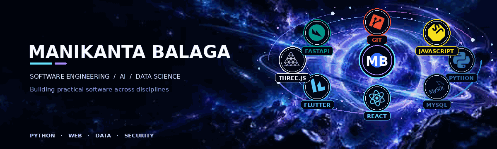

<!-- Developer profile README -->

  

  

  
  
  

  

# MANIKANTA BALAGA
### Software engineering, AI, and data science.

I’m a third-year B.Tech Computer Science and Engineering (Data Science) student at **Dhanekula Institute of Engineering and Technology**, based in Vijayawada, India. I build practical projects across creative software, application security, data science, and computer vision.

## Public repositories

All public project repositories are indexed below. This list refreshes automatically.

<!-- PUBLIC_REPOSITORIES:START -->
- [ai-printos](https://github.com/manikantakarthik30-blip/ai-printos)
- [BUSINESS-DASHBOARD](https://github.com/manikantakarthik30-blip/BUSINESS-DASHBOARD)
- [CYBER-OS](https://github.com/manikantakarthik30-blip/CYBER-OS)
- [fake-job-detector](https://github.com/manikantakarthik30-blip/fake-job-detector)
- [job-grief-counselor](https://github.com/manikantakarthik30-blip/job-grief-counselor)
- [nishiratrade](https://github.com/manikantakarthik30-blip/nishiratrade)
- [python-for-data-science](https://github.com/manikantakarthik30-blip/python-for-data-science)
- [smart-canal-intelligence-system](https://github.com/manikantakarthik30-blip/smart-canal-intelligence-system)

[View all public repositories](https://github.com/manikantakarthik30-blip?tab=repositories)
<!-- PUBLIC_REPOSITORIES:END -->

[View all public repositories](https://github.com/manikantakarthik30-blip?tab=repositories)

> Software engineering student focused on practical projects in AI, data science, application security, and interactive software.

## All public repositories

A concise directory of every public project repository on this profile.

<table>
  <tr>
    <td width="50%" valign="top">
      
<strong>01 / CREATIVE SOFTWARE</strong>

      <h3>AI Print OS</h3>
      Browser-based print design editor with templates, text and image editing, layer controls, project storage, and PNG/PDF export.
      
<strong>Stack:</strong> HTML · CSS · JavaScript

      <a href="https://github.com/manikantakarthik30-blip/ai-printos">View repository →</a>
    </td>
    <td width="50%" valign="top">
      
<strong>02 / APPLICATION SECURITY</strong>

      <h3>Cyber-OS</h3>
      Security platform focused on source and dependency checks, repository scanning workflows, findings, and remediation guidance.
      
<strong>Stack:</strong> Flutter · Dart · Python · FastAPI

      <a href="https://github.com/manikantakarthik30-blip/CYBER-OS">View repository →</a>
    </td>
  </tr>
  <tr>
    <td width="50%" valign="top">
      
<strong>03 / COMPUTER VISION</strong>

      <h3>Smart Canal Intelligence System</h3>
      Canal-monitoring prototype with a 3D UAV scene, dashboard, detection overlays, hotspot views, alerts, and PDF reports.
      
<strong>Stack:</strong> React · TypeScript · Three.js

      Detection labels and incident figures are demo data, not live municipal telemetry. 
      <a href="https://github.com/manikantakarthik30-blip/smart-canal-intelligence-system">View repository →</a>
    </td>
    <td width="50%" valign="top">
      
<strong>04 / FINANCIAL APPLICATIONS</strong>

      <h3>NishiraTrade</h3>
      Paper-trading application concept for exploring market views, virtual portfolios, watchlists, and order workflows.
      
<strong>Repository:</strong> nishiratrade

      <a href="https://github.com/manikantakarthik30-blip/nishiratrade">View repository →</a>
    </td>
  </tr>
  <tr>
    <td width="50%" valign="top">
      
<strong>05 / MACHINE LEARNING</strong>

      <h3>Fake Job & Internship Detector</h3>
      Machine-learning project for classifying potentially fraudulent job and internship listings.
      
<strong>Methods:</strong> Random Forest · XGBoost · Logistic Regression · TF-IDF

      <a href="https://github.com/manikantakarthik30-blip/fake-job-detector">View repository →</a>
    </td>
    <td width="50%" valign="top">
      
<strong>06 / AI CAREER SUPPORT</strong>

      <h3>Job Grief Counselor</h3>
      Structured career-support assistant for job-loss support, resume feedback, interview preparation, and career action plans.
      
<strong>Stack:</strong> Python · Google ADK

      <a href="https://github.com/manikantakarthik30-blip/job-grief-counselor">View repository →</a>
    </td>
  </tr>
  <tr>
    <td width="50%" valign="top">
      
<strong>07 / DATA SCIENCE LEARNING</strong>

      <h3>Python for Data Science</h3>
      Ongoing practice repository for Python, data analysis, visualization, and machine-learning fundamentals.
      
<strong>Libraries:</strong> NumPy · Pandas · Matplotlib · Seaborn · Scikit-learn

      <a href="https://github.com/manikantakarthik30-blip/python-for-data-science">View repository →</a>
    </td>
    <td width="50%" valign="top">
      
<strong>COMPLETE DIRECTORY</strong>

      <h3>Browse all repositories</h3>
      The profile includes public repositories only. Private repositories remain visible only to authorized users.
        
      <a href="https://github.com/manikantakarthik30-blip?tab=repositories">Open GitHub repositories →</a>
    </td>
  </tr>
</table>

  

## Technical skills

**Programming & data**

  
  
  
  
  

**Web & application development**

  
  
  
  
  
  
  

**Backend & tools**

  
  
  
  
  

*These labels reflect tools present in the repositories, not a claim of expert-level proficiency.*

## Academic record

- **8.3 GPA** — academic performance reported for B.Tech coursework.
  

## Build philosophy

- Build to learn; document what actually works.
- Separate prototype data from production data.
- Treat security, accessibility, and reliable setup instructions as product features.
- Prefer useful engineering over decorative complexity.

## Contact

Interested in practical software, AI, data, security, or interactive UI work.

  
  <!-- Add a LinkedIn URL or email here only after confirming the exact public contact link. -->

  
  

Software engineering • Open source • Continuous learning

