<!--
  GitHub profile README
  Copyright (c) 2026 B_MANIKANTA_1805. See LICENSE.
-->

  

  

  
  
  

  

## About

I'm **B. Manikanta (Karthik)**, a B.Tech student in **Computer Science and Engineering (Data Science)** at **Dhanekula Institute of Engineering and Technology**.

I work on software and data-focused projects, with an interest in practical machine learning, data workflows, and clear user interfaces.

- **Core technologies:** Python, SQL, HTML, CSS, and JavaScript.
- **Learning focus:** applied data science, machine learning, databases, and software engineering.
- **Achievement:** CALIBO AI Academy — Top Performer.
- **Approach:** build useful features, document decisions, and improve through testing.

## Technologies

  
  
  
  
  

  
  
  
  

  
  
  
  
  

  

## Selected projects

<table>
  <tr>
    <td width="50%" valign="top">
      <h3>Smart Canal Intelligence System</h3>
      AI-assisted canal monitoring project focused on visible waste detection, video analysis, and monitoring workflows.
        
      
    </td>
    <td width="50%" valign="top">
      <h3>Nishira.Trade</h3>
      A paper-trading project exploring virtual portfolios, market data, watchlists, and trading workflows.
        
      
    </td>
  </tr>
  <tr>
    <td width="50%" valign="top">
      <h3>Fake Job & Internship Detector</h3>
      A project aimed at helping users assess potentially suspicious job and internship opportunities.
        
      
    </td>
    <td width="50%" valign="top">
      <h3>AI Print OS</h3>
      An in-development print-design and marketplace concept combining design tools with print-product workflows.
        
      Private project — repository not linked publicly.
    </td>
  </tr>
</table>

  

## GitHub contributions

  

  

The heatmap above is provided by a third-party chart service using public GitHub contribution data. For the authoritative contribution totals and details, check the [official GitHub profile contribution calendar](https://github.com/manikantakarthik30-blip). A third-party image may be cached or temporarily unavailable; it does not create or modify contributions.

## Contact

  

  © 2026 B_MANIKANTA_1805. All rights reserved. See <a href="./LICENSE">LICENSE</a>.

