<!--
  Cinematic developer profile | Copyright (c) 2026 B_MANIKANTA_1805
  Original profile assets are proprietary. See LICENSE.
-->

  

  

  
  
  

  

## About me

👋 Hi, I'm **B. Manikanta**, a B.Tech Computer Science student specializing in Data Science.

💻 I enjoy building projects that solve real-world problems and exploring how technology, AI, and machine learning can make everyday tasks easier.

🚀 I've worked on projects like **Nishira.Trade**, a paper trading platform with AI-powered features, and a **Fake Job & Internship Detector** that uses machine learning to identify potentially fraudulent opportunities.

🛠️ I mainly work with Python, JavaScript, React.js, and Supabase. I'm also exploring AI tools, prompt engineering, and full-stack development to improve my skills and build better applications.

📚 I'm always learning something new, experimenting with ideas, and turning what I learn into practical projects.

🤝 I'm open to learning from others, collaborating on interesting projects, and growing as a developer.

## Technology systems

  
  
  
  
  

  
  
  
  

  
  

  

## Featured builds

<table>
  <tr>
    <td width="50%" valign="top">
      <h3>🌊 Smart Canal Intelligence System</h3>
      AI-assisted canal monitoring concept focused on visible waste detection, video analysis, and monitoring workflows.
        
      
    </td>
    <td width="50%" valign="top">
      <h3>📈 Nishira.Trade</h3>
      A paper-trading project exploring virtual portfolios, market data, watchlists, and trading workflows.
        
      
    </td>
  </tr>
  <tr>
    <td width="50%" valign="top">
      <h3>🛡️ Fake Job & Internship Detector</h3>
      A project aimed at helping users assess suspicious job and internship opportunities.
        
      
    </td>
    <td width="50%" valign="top">
      <h3>🎨 AI Print OS</h3>
      An in-development print-design and marketplace concept combining creative tools with print-product workflows.
        
      Private project — not publicly linked.
    </td>
  </tr>
</table>

  

## GitHub telemetry

  
  

### Contribution waveform

  

> The contribution snake is generated by GitHub Actions. Its image appears after the workflow completes successfully for the first time.

## Connect

  

  Using AI as a working  my personal partner

---

  © 2026 B_MANIKANTA_1805. Original profile assets are proprietary. All rights reserved. See <a href="./LICENSE">LICENSE</a>. Third-party names and logos belong to their respective owners.

