<!--
  GitHub profile README
  Copyright (c) 2026 B_MANIKANTA_1805. See LICENSE.
-->

  <table>
    <tr>
      <td align="center" width="30%">
        
      </td>
      <td align="center" width="40%">
        
        <h1>B. MANIKANTA</h1>
        
<strong>B.Tech — Computer Science & Engineering (Data Science)</strong>

        
Python · Data Science · Web Development · AI Projects

      </td>
      <td align="center" width="30%">
        
      </td>
    </tr>
  </table>
  

    
    
  

  

## About Me

I'm a B.Tech student in **Computer Science and Engineering (Data Science)** at **Dhanekula Institute of Engineering and Technology**. I build software and data-focused projects and am developing my skills in Python, SQL, data science, and web technologies.

- **Core skills:** Python, SQL, HTML, CSS, JavaScript
- **Technical interests:** Applied data science, machine learning, databases, and software development
- **Achievement:** CALIBO AI Academy — Top Performer

## Technical Skills

  
  
  
  
  
  
  
  
  
  
  
  
  

  

## Featured Projects

<table>
  <tr>
    <td width="50%" valign="top">
      <h3>Smart Canal Intelligence System</h3>
      AI-assisted canal monitoring project focused on visible waste detection, video analysis, and monitoring workflows.
        
      
    </td>
    <td width="50%" valign="top">
      <h3>Nishira.Trade</h3>
      Paper-trading project exploring virtual portfolios, market data, watchlists, and trading workflows.
        
      
    </td>
  </tr>
  <tr>
    <td width="50%" valign="top">
      <h3>Fake Job & Internship Detector</h3>
      A project intended to help assess potentially suspicious job and internship opportunities.
        
      
    </td>
    <td width="50%" valign="top">
      <h3>Python for Data Science</h3>
      A repository for Python and data science learning materials.
        
      
    </td>
  </tr>
</table>

  

## GitHub Activity

  
  

  

  

  

Activity charts are supplied by third-party services and may be cached or differ in coverage from GitHub's official contribution calendar. The official profile is the source of truth for contribution activity. No contribution totals are manually added here.

## Connect With Me

  
  

---

Iron Man and Thor GIFs are embedded from Tenor. Original reactor, lightning, Stormbreaker-inspired, and Mjölnir-inspired SVG assets are included in this repository. Third-party character names and imagery belong to their respective owners.

© 2026 B_MANIKANTA_1805. All rights reserved. See <a href="./LICENSE">LICENSE</a>.

